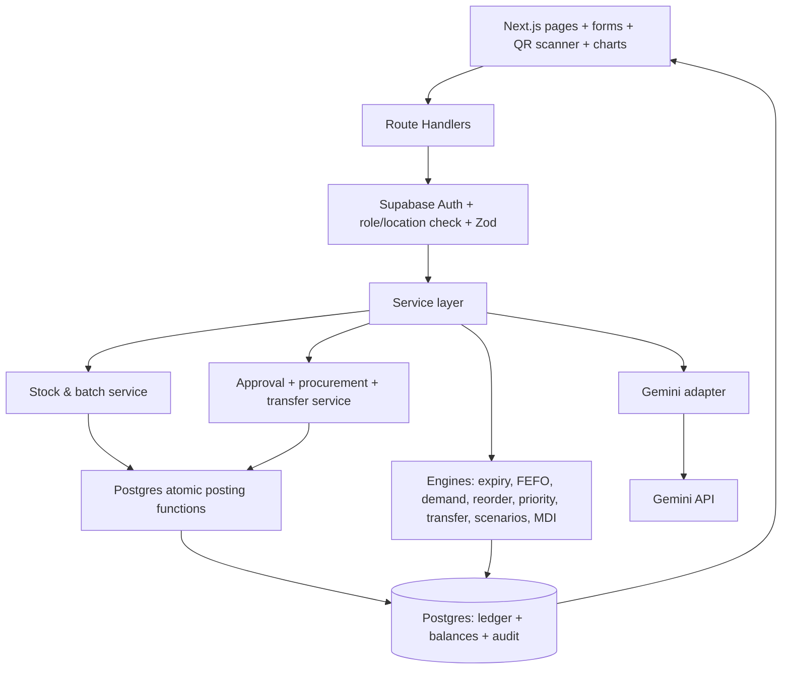

# ARCHITECTURE — MediGuard AI

**Rule of change:** any architecture change must update this file, the DB/API contract, and the matching tests together.

## 1. Stack (fixed)

| Layer | Choice |
|---|---|
| App | Next.js (App Router) + TypeScript, Route Handlers as the backend |
| UI | Tailwind CSS, shadcn/ui, Recharts |
| DB/Auth | Supabase PostgreSQL + Auth + RLS; optional Realtime |
| Atomic writes | Restricted PostgreSQL functions (RPC) with row locks + idempotency keys |
| AI | Gemini via `@google/genai`, **server-side only**, Zod-validated structured output |
| Validation | Zod (requests + AI output), Papa Parse (CSV) |
| QR | `@zxing/browser` (scan) + QR generator; manual entry fallback |
| Tests | Vitest (engines + selected API), Playwright smoke (optional) |
| Hosting | Vercel (app) + Supabase (managed) |
| **Excluded** | FastAPI, Docker, Redis/queues, client-side secrets, custom ML, fabricated AI stock data |

## 2. System diagram



**Write path:** command → auth/role/location → Zod → domain guards → **one** atomic SQL function → movement + balance + audit → refetch → UI.
**Read/decision path:** authorized DB rows → pure engine → factors + candidates → optional bounded Gemini summary → human approval → write path.

**Layer responsibilities**

| Layer | Does | Must NOT |
|---|---|---|
| `app/` (pages) | Render, call API, show states | Compute business values, hold secrets |
| `app/api/**/route.ts` | Auth, Zod parse, call service, map errors | Contain business formulas |
| `services/` | Load data, call engines, call RPC, write audit | Mutate balances with plain `UPDATE` |
| `engines/` | Pure functions: input → output | Touch DB, network, `Date.now()` directly (take `now` as a param) |
| `lib/gemini/` | Build minimized payload, call model, validate | Send patient data, execute actions |
| Postgres RPC | Locks, checks, ledger+balance+audit in one txn | Trust client-supplied actor id |

## 3. Data model

| Table | Key fields | Notes |
|---|---|---|
| `user_profiles` | `id, role, assigned_location_id, active` | Links auth user → scope |
| `locations` | `id, name, type, storage_capabilities, active` | Central pharmacy, wards, OT, satellite |
| `medicines` | `id, sku, generic_name, unit, category, criticality, storage_requirements, active` | Criticality from master data |
| `suppliers` | `id, name, lead_time_days, accepts_returns, return_window_days, reliability_metadata` | Policy data |
| `batches` | `id, medicine_id, supplier_id, batch_code, expires_on, unit_cost, received_on, status` | One batch → many locations. `status`: ACTIVE/QUARANTINED/RECALLED/BLOCKED/EXPIRED |
| `stock_balances` | `batch_id, location_id, quantity, version` | PK (batch, location). **Only RPC mutates** |
| `stock_movements` | `id, idempotency_key, batch_id, type, from_location_id, to_location_id, quantity, actor_id, occurred_at, reason, reference_id` | Immutable ledger |
| `physical_counts` | `id, batch_id, location_id, counted_quantity, system_quantity, status, requested_by, approved_by` | Adjustment only after approval |
| `demand_adjustments` | `id, medicine_id, location_id, multiplier, start_date, end_date, reason` | Staff-entered demand change |
| `transfer_requests` | `id, batch_id, source_id, destination_id, quantity, rationale, status, approved_by` | PENDING→APPROVED→EXECUTED / REJECTED |
| `procurement_requests` | `id, medicine_id, location_id, supplier_id, quantity, price_estimate, status, priority_explanation, approved_by` | REQUESTED→APPROVED→ORDERED→RECEIVED |
| `return_disposal_requests` | `id, batch_id, location_id, quantity, type, eligibility_evidence, status, approved_by` | RETURN / DISPOSAL |
| `rule_configs` | `scope, rule_key, value_json, changed_by, updated_at` | Defaults + location/item overrides |
| `audit_events` | `id, actor_id, action, entity_type, entity_id, before_json, after_json, created_at` | Append-only |
| `ai_reports` | `id, requested_by, source_record_ids, output_text, created_at, model_id` | Optional; no PHI |

**Derived views (never independent mutable truth):** `daily_consumption`, `near_expiry_batches`, `current_usable_stock`, `purchase_priority_queue`, `risk_summary`.

### Hard invariants
1. `stock_balances.quantity >= 0` on every commit (CHECK constraint **and** RPC guard).
2. Every movement has actor + timestamp; quantity `> 0` (CHECK).
3. FEFO/transfer excludes expired, quarantined, recalled, blocked lots.
4. Transfer updates source + destination in **one** txn; duplicate idempotency key rejected.
5. Procurement approval never adds stock; only `RECEIPT` does.
6. Legal state transitions only; executed requests can't re-execute.
7. Audit rows can't be updated/deleted from the app (no UPDATE/DELETE grant; trigger blocks).
8. RLS **and** server checks enforce access; service key server-only.
9. Timestamps stored as `timestamptz` (UTC); expiry as `date`; usable **until the day before** `expires_on`.
10. Money = `numeric(12,2)`; quantities = integer unless item allows fractions.

### Core RPC sketch (the only stock-write path)

```sql
create or replace function post_movement(
  p_idempotency_key text, p_batch_id uuid, p_type text,
  p_from uuid, p_to uuid, p_qty int, p_reason text, p_reference uuid
) returns uuid
language plpgsql
security definer
set search_path = public          -- REQUIRED for security definer
as $$
declare v_actor uuid := auth.uid(); v_id uuid; v_bal int; v_status text; v_exp date;
begin
  if v_actor is null then raise exception 'unauthenticated'; end if;
  if p_qty <= 0 then raise exception 'qty must be positive'; end if;

  -- idempotency: return existing movement instead of double posting
  select id into v_id from stock_movements where idempotency_key = p_idempotency_key;
  if found then return v_id; end if;

  -- role/location check (read from user_profiles, never from client)
  perform assert_can_move(v_actor, p_type, p_from, p_to);

  select status, expires_on into v_status, v_exp from batches where id = p_batch_id;
  if p_type in ('ISSUE','TRANSFER','RETURN') and (v_status <> 'ACTIVE' or v_exp <= current_date)
    then raise exception 'batch not eligible'; end if;

  if p_from is not null then
    select quantity into v_bal from stock_balances
      where batch_id = p_batch_id and location_id = p_from for update;   -- row lock
    if v_bal is null or v_bal < p_qty then raise exception 'insufficient stock'; end if;
    update stock_balances set quantity = quantity - p_qty, version = version + 1
      where batch_id = p_batch_id and location_id = p_from;
  end if;
  if p_to is not null then
    insert into stock_balances(batch_id, location_id, quantity, version)
      values (p_batch_id, p_to, p_qty, 1)
      on conflict (batch_id, location_id)
      do update set quantity = stock_balances.quantity + excluded.quantity,
                    version = stock_balances.version + 1;
  end if;

  insert into stock_movements(...) values (...) returning id into v_id;
  insert into audit_events(...) values (...);
  return v_id;
end $$;

revoke execute on function post_movement from public, anon;
grant  execute on function post_movement to authenticated;
```

Movement types: `RECEIPT, ISSUE, TRANSFER, RETURN, DISPOSAL, ADJUSTMENT`. Lock order: always lock rows in `(batch_id, location_id)` order to avoid deadlocks on concurrent transfers.

## 4. Access control

- **Server:** every route calls `requireUser()` → loads `user_profiles` → checks role + location scope → Zod.
- **RLS (all tables enabled):** STAFF read/write limited to `assigned_location_id`; MANAGER cross-location read as authorized; ADMIN config + audit read. No client policy allows direct `INSERT/UPDATE` on `stock_balances` or `stock_movements`; they are written only through RPC.
- **Approvals:** role check inside the RPC/decision function, not only in the route (test #11: direct API call by STAFF must fail).
- **Secrets:** `GEMINI_API_KEY` and any service-role key exist only in server env. Never `NEXT_PUBLIC_`.

## 5. Decision engines (pure TS, in `src/engines/`)

Every engine takes explicit `settings` and `now`. No DB access.

| Engine | File | Core logic |
|---|---|---|
| E2 Expiry + FEFO | `expiry.ts`, `fefo.ts` | `days_to_expiry` = calendar diff in hospital TZ. Bands 7/15/30/60 configurable. Per medicine-location: sort eligible batches by `expires_on`, then `received_on`; simulate daily consumption allocated to earliest-expiring first. `projected_at_risk_units = max(0, remaining_at_expiry)`; `value = units × unit_cost` (estimate) |
| E3 Demand | `demand.ts` | From `ISSUE`/consumption events by medicine+location+day. Enough history: `0.6×avg7 + 0.4×avg30` (configurable). Sparse: 30-day/manual baseline + `LOW_DATA_CONFIDENCE`. Apply approved `demand_adjustments` multiplier. No fake seasonality, no probabilities |
| E4 Reorder | `reorder.ts` | `coverage_days = lead_time + review_period`; `target = ceil(daily×coverage + safety)`; `eligible = non-expired/non-blocked usable in window`; `effective_supply = eligible + confirmed_incoming + approved_inbound_transfers` (**not** pending suggestions); `reorder = max(0, target − effective_supply)`; pack-size rounding; compare transfer first, recompute residual |
| E5 Priority | `priority.ts` | Separate **shortage** and **waste** 0–100 operational urgency scores with visible weighted inputs. Data quality (good/limited/stale) shown separately. No clinical probability |
| E6 MDI | `mdi.ts`, `transfer.ts` | Generates candidates `USE_FEFO, TRANSFER, RETURN_TO_SUPPLIER, REORDER, DISPOSAL_REVIEW, RECONCILE`. Drops infeasible ones. Ranks by urgency + impact among feasible only. Stale/discrepant data → `RECONCILE`/`REVIEW_DATA` first |
| E7 Scenarios | `scenarios.ts` | `before`, `after`, `potential value preserved`, assumptions, caveats. Always "projected" |
| E8 Gemini adapter | `lib/gemini/` | Minimized payload → structured JSON → Zod → render with real links; fallback to deterministic text |

### MDI candidate shape
```ts
type Candidate = {
  type: 'USE_FEFO'|'TRANSFER'|'RETURN_TO_SUPPLIER'|'REORDER'|'DISPOSAL_REVIEW'|'RECONCILE';
  medicine_id: string; batch_id?: string;
  source_location?: string; destination_location?: string;
  proposed_units: number; expected_value_impact: number;
  eligibility_checks: { name: string; passed: boolean; detail: string }[];
  source_record_ids: string[]; explanation: string;
  data_freshness: 'good'|'limited'|'stale'; confidence_flags: string[];
  requires_approval: true;
};
```

### Transfer feasibility checks (all must pass)
donor has safe surplus (after its own coverage) · recipient has documented need · storage compatibility (cold chain etc.) · remaining shelf life after delivery ≥ margin · batch eligible · location transfer restrictions (rule_configs) · quantity ≤ min(donor surplus, recipient need).

### Gemini payload & output
```ts
// out
{ summary: string,
  findings: { source_record_ids: string[]; explanation: string }[],
  recommended_review_questions: string[],
  limitations: string[] }
```
Prompt forbids: inventing facts, authorizing purchases, prescribing, overriding hard rules, presenting estimates as certain. IDs not present in the input payload are **dropped** before rendering.

## 6. API inventory (`src/app/api/**/route.ts`)

| Route | Purpose |
|---|---|
| `GET /api/dashboard` | KPIs + filters |
| `GET, POST /api/medicines` · `GET, PATCH /api/medicines/:id` | Master data |
| `GET, POST /api/batches` | Batch metadata |
| `POST, GET /api/stock/movements` | Post (via RPC) / trace |
| `POST /api/stock/counts` | Physical count |
| `GET /api/expiry` · `GET /api/forecasts` · `GET /api/recommendations` | Engine outputs |
| `GET, POST /api/transfers` · `POST /api/transfers/:id/decision` | Transfer workflow |
| `GET, POST /api/procurement` · `POST /api/procurement/:id/decision` | Procurement workflow |
| `GET /api/suppliers` | Supplier metrics + return eligibility |
| `POST /api/imports/preview` · `POST /api/imports/commit` · `GET /api/exports/:type` | CSV |
| `POST /api/ai/explain` | Grounded Gemini summary |
| `GET, PATCH /api/settings` · `GET /api/audit` | Admin |

All schemas live in `src/schemas/` and are shared by server + UI. Standard error shape: `{ error: { code, message, fields? } }`. Do not generate endpoints nobody uses.

## 7. Realtime & consistency
- UI never shows a stock write as final until the server commits. After success, invalidate/refetch affected queries.
- Other sessions: Supabase Realtime on `stock_balances`/`transfer_requests` (RLS applies), with 10–15 s polling fallback.
- No offline writes.

## 8. Failure & fallback matrix

| Failure | Behavior |
|---|---|
| Gemini down / invalid JSON / timeout | Show deterministic explanation + "AI summary unavailable"; everything else works |
| Camera denied / no camera | Manual code entry + batch search |
| Realtime socket drops | Polling fallback |
| Import has bad rows | Preview with row-level errors; commit only valid rows if user chooses |
| RPC rejects (insufficient, duplicate, ineligible) | Typed error → clear UI message; balance unchanged |

## 9. Repository layout

```text
mediguard-ai/
├─ README.md  AGENTS.md  RULES.md  PRD.md  ARCHITECTURE.md  DESIGN.md  IMPLEMENTATION_PLAN.md
├─ .env.example
├─ docs/            (DATABASE_AND_API.md, DECISION_ENGINE_RULES.md, TEST_PLAN.md, DEMO_SCRIPT.md)
├─ src/
│  ├─ app/ (auth)/login · (dashboard)/{dashboard,inventory,risks,procurement,insights} · api/
│  ├─ components/ {layout,dashboard,inventory,risks,procurement,insights,scanner,ui}
│  ├─ lib/ {supabase,auth,validators,utils,gemini}
│  ├─ engines/ {expiry,fefo,demand,reorder,priority,transfer,scenarios,mdi}.ts
│  ├─ services/ {inventory,movements,procurement,recommendations,imports,audit}.ts
│  ├─ schemas/   types/
├─ supabase/ {migrations/, seed.sql}
├─ scripts/generate-demo-data.ts
└─ tests/ {engines, api, smoke}
```

## 10. Environment

```
NEXT_PUBLIC_SUPABASE_URL=
NEXT_PUBLIC_SUPABASE_PUBLISHABLE_KEY=
GEMINI_API_KEY=            # server-only
HOSPITAL_TIMEZONE=Asia/Kolkata
SEED_ALLOWED_PROJECT_REF=  # seed/reset refuses to run against any other project
```

## 11. Hidden gotchas (the stuff that bites at hour 6)

1. **`security definer` without `set search_path`** is a privilege-escalation hole. Always set it; revoke `execute` from `public`/`anon`.
2. **Postgres `numeric`/`bigint` arrive as strings** in JS clients. Parse in one mapper layer, never in components, or sums become string concatenations.
3. **Next.js dynamic `params` can be async** in newer versions — `await` them in route handlers; check the installed version first instead of copying old snippets.
4. **Vercel serverless timeouts**: keep engine runs per-request small (aggregate in SQL views, simulate only the needed medicine-location) and cap Gemini calls with a timeout + `AbortController`.
5. **RLS + Realtime**: subscriptions only deliver rows the user can `select`; enable RLS before testing realtime or you'll see everything and think it works.
6. **Seed dates must be relative** (`current_date + n`) — hard-coded dates make the "near-expiry" demo silently turn into "expired".
7. **Idempotency key is generated when the dialog opens**, not on click; otherwise a double-click creates two keys and two postings.
8. **Never trust `actor_id` from the body** — derive from `auth.uid()` inside the RPC.
9. **Pure-engine purity**: pass `now` in. Tests that depend on the wall clock become flaky around midnight.
10. **CSV formula injection**: prefix `'` to cells starting with `= + - @` on export; reject on import.
11. **Free Supabase projects pause** after inactivity — wake it before judging.
12. **Camera API requires a secure origin** (HTTPS or localhost).
